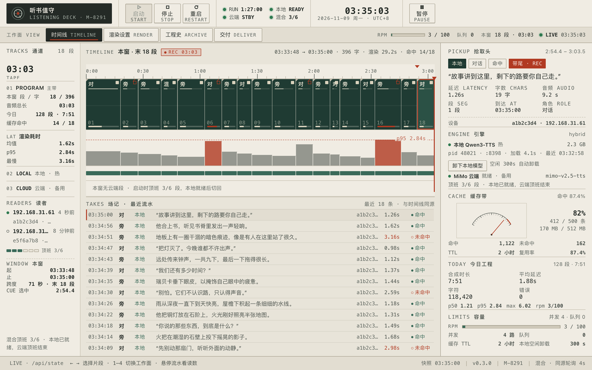
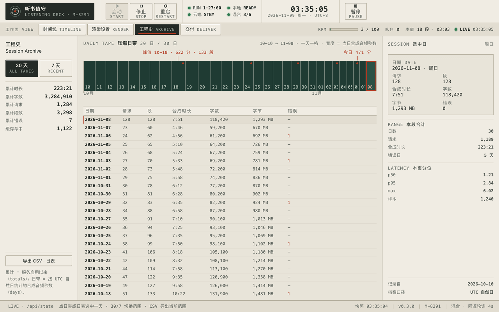

# MiMo TTS 听书服务 · DSH 插件

给「阅读」(Legado) 用的在线听书代理，**一个插件里同时放进服务本体和控制台**。

- 旁白/对话按引号自动分音色，同一角色相邻句合并
- 每段返回**长度正确的完整 WAV**，阅读进度和自动翻页不会错位
- 端口 / API Key / 音色 / 风格 / 缓存 / 鉴权全部在页面里改，改完即生效
- 一个地址丢给 Legado 就能导入（`/legado.json`），不用手填 Body 和 Header
- 默认云端零依赖：不装 Python、不装 ffmpeg、不 `npm install` 运行时依赖
- 可选本地 Qwen3-TTS：按需拉起 sidecar，空闲自动卸载（macOS Apple Silicon）
- 侧栏「听书值守」进控制台：时间线 / 渲染设置 / 工程史 / 交付，一台「剪辑台」



---

## 三种跑法

```bash
# 1) 插件形态（在 DSH 里）
#    装进 profile 后在侧栏出现「听书值守」，服务随插件自动启动
dsh plugin --profile desktop add link:/绝对路径/mimo-tts-plugin
#    然后把 @local/mimo-tts 加进该 profile 的 dsh.profile.bundles

# 2) 独立服务（不依赖 DSH，NAS / Docker 上长期跑）
node bin/mimo-tts.mjs                 # 默认 0.0.0.0:8291，数据在 ./data
node bin/mimo-tts.mjs --port 8291 --data /var/lib/mimo-tts

# 3) 只当库用
import { TtsService } from './src/service.mjs'
```

---

## 本地引擎（可选）

默认仍然走 MiMo 云。想换成本机 Qwen3-TTS：

1. 跑 `./sidecar/install.sh`（或按 [sidecar/README.md](sidecar/README.md) 手动建 venv、下模型），准备两条参考音；
2. 控制台「参数 → 引擎」选「本地 Qwen3-TTS」，填 Python / 模型 / 参考音，保存；
3. 或直接改 `config.json` 的 `upstream.provider = "local"`。

行为：

- **模型不常驻**：第一次请求才拉起 sidecar；空闲 `idleUnloadSeconds`（默认 300 秒）
  后整个 Python 进程退出，约 2.3 GB 内存还给系统。`0` = 常驻。
- 冷启动约 12 秒（模型加载 4 s + 首请求 MLX 编译 8 s）；之后 3–6 秒/段。
- 整章实测累计 RTF 0.65（11.7 分钟音频 / 7.6 分钟生成），详见
  [bench/REPORT.md](bench/REPORT.md)。
- 只有 macOS Apple Silicon 能用；Linux/NAS 继续用云端。
- 本地路径固定返回完整 WAV（Legado 进度正确），**不走流式**。

### 混合启动（推荐给「在乎首段等待」的场景）

`upstream.provider = "hybrid"`，同时需要本地参考音和 MiMo API Key：

- 冷启动的前 2–4 段走 **MiMo 克隆**（用本地同一条参考音），后台同时加载本地模型；
- 本地热了自动切本地，之后不再用云；
- 云端/本地输出统一归一化到约 −18 dBFS，避免切点时音量跳变；
- 首段实测 3–5 s（纯本地冷启动是 11.7 s），之后本地；
- 云端请求超过 4 s 预算就转本地；本地已热时云/本地整段竞速，谁先完成用谁；
- `maxCloudBootstrap` 只控制「预热尝试上限」，超过后仍由云兜底，本地错误会显示在控制台。
- 已知边界：冷启动第二段若撞上云端 429，本地预热还没完成，可能有一次 5–8 s 空档
  （实测 p2 7.24 s）；p3 之后连续。

注意：两套模型的音色/韵律不完全一致（同参考音 CAM++ 约 0.82–0.86），
切换那一句可能听得出。建议先听 `bench/runs/hybrid/switch.wav` 再决定是否默认开。

---

## 接进 Legado

1. 打开控制台，确认服务在跑、端口是什么；
2. 复制「导入地址」，形如 `http://192.168.1.5:8291/legado.json?token=…`；
3. 阅读 App → 朗读 → 在线朗读 → 右上角「导入」→ 粘贴地址；
4. 引擎列表里会出现 **MiMo TTS 听书**，选中即可。

导入的规则长这样（`{{…}}` 是 Legado 自己的 JS 求值）：

```
http://<ip>:<port>/listening?token=…,{"method":"POST",
  "body":"text={{java.encodeURI(speakText)}}&speed={{speakSpeed}}",
  "header":{"Content-Type":"application/x-www-form-urlencoded"}}
```

用 form 编码而不是 JSON，是因为 `java.encodeURI` 就是 `URLEncoder.encode(…, "UTF-8")`，
中文和引号都能安全过；JSON body 还要处理 `"` 转义，书里一出现引号就炸。

> **建议在 Legado 里打开「流式朗读」**（朗读设置 → 流式朗读）。
> 不开也能用，但每段要等整段合成完才播。

---

## 控制台

从左栏的「听书值守」图标进入。整台是「**多轨剪辑台**」：把朗读流当磁带在走，四个功能域是同一台机器的四个工作面。

| 工作面 | 内容 |
|---|---|
| **时间线** | 启停/重启/暂停（走带）、RUN/本地/云端/混合灯、RPM/队列、轨道头（TAPE/PROGRAM/LAT/本地/云端/读者/窗口）、节目带（每段宽度 = 音频秒数、段内缝 = 分段数、底刻条 = 延迟、缓存断口、旁/对/混角色）、拾取头（选中片段的全部读数 + 引擎 + 缓存 VU + 今日）、场记流水 |
| **渲染设置** | 六模块带机架：引擎（来源/云顶班/云并发/预热/目标响度/模型）、本地引擎（Python/Sidecar/模型/端口/超时/参考音）、音色、合成与缓存（旋钮绑真值）、传输（监听/对外地址/上游/Key/超时/重试/附加头）、鉴权（Basic/令牌/日志环）；右侧生效面板显示脏标清单与最后生效时间 |
| **工程史** | 30/7 天范围、压缩日带（一天一格，宽度 = 当日合成音频秒数，峰值/今日批注）、日表、选中日详情、区间合计、延迟分位、CSV 导出 |
| **交付** | Legado 导入地址 / 朗读 URL / 局域网与公网地址、METHOD/BODY/CONTENT-TYPE、令牌、并发限速、curl 试一句、错误码、四步接入清单、一键复制 |



### 设计与构建

> 这个分发包里没有 `docs/redesign/`（三个方向的设计评审稿，28 MB），
> 只带了四张成品截图。下文的 `docs/redesign/*.html` 链接在原仓库里。

界面设计在 `docs/redesign/` 里选型：三个结构级方向（D1 总机 / D2 多轨 / D3 册页）在
[docs/redesign/index.html](docs/redesign/index.html) 并排评审，最终落地 **D2 多轨 · 剪辑台**；
设计稿与决策说明在 [docs/redesign/d2-timeline.html](docs/redesign/d2-timeline.html) /
[d2-concept.md](docs/redesign/d2-concept.md)。

样式是 `docs/redesign/d2-timeline.html` 的 `<style>` 机械搬迁到 `.mtt` 作用域（容器查询替代视口
media query、`100vh` → `100%`），存为 [src/deck.css](src/deck.css)；`client.template.js` 是 React `h()`
手写的单文件实现。改界面：改 `client.template.js` 或 `src/deck.css`，然后：

```bash
python3 tools/build-client.py   # 把 deck.css 注入模板，生成 client.js（单文件、零外部请求）
node --check client.js          # 语法自检
```

`tools/scope-console-css.py` 是上一版记录纸材质迁移时的一次性脚本，现在只作历史参考。

### 真实渲染验收

插件的浏览器半边依赖宿主的 `require('react')`，直接打开 `client.js` 看不到界面。仓库里带了一个
零依赖 harness（`docs/redesign/harness/`）：用 React UMD + 最小 ModuleLoader 垫片挂载构建产物，
用 fixture 或真实服务喂 `/mimo-tts/api/*`，再用 playwright 截图四域与关键交互。

```bash
node docs/redesign/harness/server.cjs --port 8711
NODE_PATH=~/.local/lib/node_modules node docs/redesign/harness/shoot.cjs
# 截图与断言输出在 docs/redesign/harness/shots/
```

数据全部来自宿主半边的 `/mimo-tts/api/*`：同源、无跨域，页面拿到的密钥永远是掩码；
面板里 `.mtt` 撑满可用高度并让出 `--dsh-frame-top-clearance`，900–1600 宽不横向溢出。

---

## 外网访问（Cloudflare Tunnel）

服务像个普通 HTTP 后端一样挂在隧道后面即可，不需要改协议、不需要 WebSocket。

**隧道在 NAS 上、服务在 Mac 上**（常见布局）：

```yaml
# ~/.cloudflared/config.yml 里的 ingress 加一条
ingress:
  - hostname: tts.example.com
    service: http://192.168.1.54:8292     # Mac 的局域网地址，别写 127.0.0.1
  - service: http_status:404
```

```bash
cloudflared tunnel route dns <隧道名> tts.example.com
# 重启 cloudflared
```

> `cloudflared` 跑在容器里时，`127.0.0.1` 指的是容器自己，所以必须写 Mac 的局域网 IP。

然后在控制台「参数 → 对外地址」填 `https://tts.example.com`，回「接入」页就能看到
**公网导入地址**；导入到阅读 App 后，朗读走公网域名，内网外网同一个引擎。

不填「对外地址」也行：`/legado.json` 会按 `X-Forwarded-Proto` / `X-Forwarded-Host`
推导（Cloudflare Tunnel 会带这两个头），只有直连时才落到 `http://内网IP`。

### 前面加一层 Cloudflare Access（推荐）

公网暴露的 TTS 会被人扫。两层防护：

1. **URL 令牌**（默认就有）——别人拿不到完整地址就用不了；
2. **Cloudflare Access 服务令牌**——在 Zero Trust 里建一个 Service Token，然后在
   控制台「参数 → 附加请求头」填入：

```json
{
  "CF-Access-Client-Id": "xxxx.access",
  "CF-Access-Client-Secret": "yyyy"
}
```

这些头会一起写进导出的朗读引擎，阅读 App 就不会被 Access 拦到登录页。

> 注意：**导入这一步**本身没法带令牌（Legado 的 URL 导入不带自定义头）。所以挂了
> Access 之后，请在局域网里导入，或者用「接入」页新增的「复制 JSON」把文本直接粘进
> 导入框。

### 要 7×24 的话

插件形态下服务跟着 DSH 走，Mac 睡眠或 DSH 退出就断。两种解法：

- 关掉 Mac 睡眠（`caffeinate -s` 或节能设置），保持 DSH 常驻；
- 或者把同一份内核放到 NAS 上跑（`node bin/mimo-tts.mjs`，零依赖），
  隧道 ingress 改成 `http://127.0.0.1:8292`，DSH 只当控制台。

---

## 为什么不用"长度未知"的流式 WAV

旧实现把 WAV 头的 `data` 长度写成 `0x7FFFFFFF` 来偷跑首音。ExoPlayer 会把时长算成
约 13 小时，而 Legado 的段落内进度是 `duration / 字数` 推的 —— 于是**长段落跨页时不会
自动翻页**。

这个服务默认返回长度真实的完整 WAV（`X-Mimo-Duration-S` 就是它算出来的时长）。
想换回低延迟优先，把「流式返回」打开即可 —— 首音更快，代价是进度失真。

真正的解法是缓存与并发：一段里的多个角色段是**并行**合成的，所以 3 段的段落在
1.5 秒内就能出结果，而不是 3 段相加。

---

## 架构

```
mimo-tts-plugin/
├── index.js              宿主半边：配置、服务生命周期、/mimo-tts/api/*
├── client.template.js    浏览器半边源码（h() 写法，样式占位）
├── client.js             构建产物：单文件，交给 DSH 的 ModuleLoader
├── src/console.css       从 mimo-listen-console 搬来的样式（.mtt 作用域）
├── tools/                build-client.py（注入 deck.css）
├── bin/mimo-tts.mjs      独立运行入口
├── src/
│   ├── config.mjs        默认值 / 读写 / 校验 / 掩码
│   ├── split.mjs         旁白·对话切分（引号深度）与合并
│   ├── wav.mjs           RIFF 解析、拼接、重采样、编码
│   ├── mimo.mjs          上游客户端：key 池、重试、流式
│   ├── cache.mjs         LRU + TTL + 字节上限
│   ├── metrics.mjs       RPM 闸门、计数、流水
│   └── service.mjs       HTTP 路由与合成流水线
└── test/                 node --test
```

服务自己开一个端口（默认 `0.0.0.0:8291`）给手机上的 Legado；
浏览器半边通过 DSH 自己的 HTTP 服务拿 `/mimo-tts/api/*` 的数据 —— 同源、
不走跨域、也不把鉴权令牌交给页面。

宿主半边与内核在同一个进程里，但内核**不 import 任何 DSH 的东西**，
所以 `node bin/mimo-tts.mjs` 能原样跑起来。

---

## 接口

| 方法 | 路径 | 用途 |
|---|---|---|
| POST/GET | `/listening` | 朗读入口（Legado 用） |
| GET | `/health` | 存活探针，免鉴权 |
| GET | `/legado.json` | Legado 一键导入 |
| POST | `/api/preview` | 试听一段文本 |
| GET | `/api/live` | 时间线（值守）数据 |
| GET/PUT | `/api/config` | 读写配置 |
| DELETE | `/api/cache` | 清空音频缓存 |

鉴权二选一：`Authorization: Basic …`，或 URL 上的 `?token=…`（首次启动自动生成）。

`/listening` 返回头里带了便于排查的信息：

```
Content-Type: audio/wav
Content-Length: 622124          ← 真实长度，播放器能算时长
X-Mimo-Segments: 2              ← 这段话被切成几段
X-Mimo-Latency-Ms: 3125         ← 端到端耗时
X-Mimo-Duration-S: 12.96        ← 音频时长
```

---

## 配置

落在 `$DSH_HOME/plugin-data/mimo-tts/config.json`（独立运行时是 `--data` 指定目录）。

```jsonc
{
  "server":   { "host": "0.0.0.0", "port": 8291 },
  "auth":     { "enabled": true, "user": "hamelin", "pass": "", "token": "自动生成" },
  "upstream": { "baseUrl": "https://api.xiaomimimo.com/v1", "keys": [], "model": "mimo-v2.5-tts" },
  "voices": {
    "narrator": { "mode": "preset", "voice": "冰糖", "style": "温润端庄的中文女声…" },
    "dialogue": { "mode": "preset", "voice": "苏打", "style": "沉稳自然的中文男声…" }
  },
  "synth": { "maxSegmentChars": 100, "concurrency": 4, "stream": false },
  "cache": { "enabled": true, "maxEntries": 500, "ttlSeconds": 7200 },
  "limits": { "rpm": 100 }
}
```

环境变量只做**首次种子**（`MIMO_API_KEY` / `MIMO_TTS_PORT` / `TTS_AUTH_*` / …）；
一旦 `config.json` 存在，以文件为准。

**`maxSegmentChars` 是延迟与请求数的旋钮**：调小 → 段更多、并行更快出首音，
但请求数上升（上游 100 RPM）；调大 → 省请求，但长段要等更久。

---

## 音色的三种模式

| mode | 模型 | 需要什么 |
|---|---|---|
| `preset` | `mimo-v2.5-tts` | 9 个内置音色之一 |
| `design` | `mimo-v2.5-tts-voicedesign` | 一句中文描述（不用录音） |
| `clone` | `mimo-v2.5-tts-voiceclone` | mp3/wav 样本的 base64，≤10MB |

只有 `preset` 有真正的低延迟流式；另外两个即使 `stream:true` 也是推理完一次吐出来。

---

## 测试

```bash
node --test test/*.test.mjs
```

覆盖：切分（引号深度、ASCII 引号归一化、超长句、同角色合并）、WAV（RIFF 头真实性、
拼接、重采样、降混、静音占位）。

---

## 已知边界

- **不能 7×24**：插件形态下 DSH 一关服务就停。要常驻用 `node bin/mimo-tts.mjs` 单独跑。
- **首段延迟**受上游影响（实测 1.2–7 s），只能靠缓存缓解，绕不过去。
- **OGG/Vorbis 不做**：纯 Node 没有可靠的 Vorbis 编码器；Legado 的 ExoPlayer 直接吃 WAV。
- **模型 ID 会变**：官方 2026-10 才下线过一批模型，所以 `upstream.model` 和 `baseUrl` 都可配。
